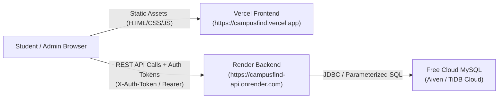

# 🚀 Complete Cloud Deployment Guide — CampusFind

This step-by-step guide explains how to deploy **CampusFind — College Lost and Found Management System** online for **free** using:
* **Frontend:** [Vercel](https://vercel.com) (Global Edge CDN for HTML5/CSS3/JavaScript)
* **Backend:** [Render](https://render.com) (Free Web Service for Spring Boot & Java 17)
* **Database:** Free Managed MySQL on [Aiven](https://aiven.io) or [TiDB Cloud](https://tidbcloud.com)

---

## 🏗️ Architecture Overview



---

## 📂 Exact GitHub Upload Manifest (Which Files & Folders to Upload)

When pushing your project to GitHub, only commit the source code and configuration. **Do not** upload temporary build files (`target/`), uploaded user images, IDE settings, or secret credentials.

### ✅ What MUST Be Uploaded to GitHub:
```
CAMPUSFIND/
├── .gitignore                            # Excludes target/, IDE files, local secrets
├── .dockerignore                         # Excludes non-essential files from Docker build
├── Dockerfile                            # Multi-stage Java 17 / Maven build container for Render
├── render.yaml                           # Infrastructure-as-code blueprint for Render
├── pom.xml                               # Maven project configuration & dependencies
├── DEPLOYMENT.md                         # This deployment guide
├── README.md                             # Project documentation & viva guide
├── application.properties.template       # Environment variable reference
├── sql/
│   └── schema.sql                        # MySQL schema & initial seed data
├── src/                                  # Java backend source code & monolithic static files
│   ├── main/java/com/campusfind/...      # Controllers, Services, Repositories, Security
│   └── main/resources/
│       ├── application.properties        # Backend config with ${ENV_VAR} fallbacks
│       └── static/...                    # Mirrored frontend for local monolithic mode
├── frontend/                             # Vercel deployment folder
│   ├── package.json                      # Vercel build script declaration
│   ├── build-env.js                      # Injects Vercel API_URL env variable into js/env.js
│   ├── vercel.json                       # Clean URLs & security headers configuration
│   ├── index.html                        # Homepage
│   ├── login.html                        # Login page
│   ├── register.html                     # Registration page
│   ├── forgot-password.html              # Password recovery request page
│   ├── reset-password.html               # Password reset page
│   ├── report-item.html                  # File lost / found report page
│   ├── my-reports.html                   # Student reports dashboard
│   ├── admin.html                        # Admin moderation panel
│   ├── css/
│   │   └── style.css                     # Premium design stylesheet
│   └── js/
│       ├── env.js                        # Runtime environment placeholder
│       ├── config.js                     # Dynamic API base URL resolver
│       ├── api.js                        # REST client with cross-origin auth token
│       └── main.js                       # Home search, filters & stats logic
└── uploads/
    └── items/
        └── .gitkeep                      # Preserves directory structure without user files
```

### ❌ What is EXCLUDED via `.gitignore` (Never Upload):
* `target/` — Compiled `.class` files, `.jar` files, and Maven temporary build artifacts (~100+ MB).
* `uploads/items/*` — Uploaded student images (only `.gitkeep` is tracked).
* `.idea/`, `.vscode/`, `*.iml` — IDE-specific workspace configurations.
* `.tools/`, `scratch/`, `test_output/` — Local testing and scratch scripts.
* `*.log` — Local runtime log files.
* `.env`, `application-local.properties` — Any files containing private local passwords.

---

## 💻 Git Commands to Push to GitHub

Run the following commands in PowerShell from the project root directory (`c:\Users\HP\Downloads\CAMPUSFIND`):

```powershell
# 1. Initialize Git (if not already initialized)
git init

# 2. Stage all allowed files (.gitignore will protect sensitive & build files)
git add .

# 3. Commit your project
git commit -m "CampusFind: Production-ready Spring Boot backend and Vercel frontend"

# 4. Set main branch
git branch -M main

# 5. Link to your GitHub repository (replace with your actual GitHub repo URL)
git remote add origin https://github.com/<your-username>/campusfind.git

# 6. Push to GitHub
git push -u origin main
```

*(Note: On Windows, if `git` is not in your system PATH, use `& "C:\Program Files\Git\cmd\git.exe"` instead of `git`)*

---

## STEP 1: Set Up a Free Cloud MySQL Database

Render's free tier does not include persistent disk storage, so a free external managed MySQL database is used:

### Option A: Aiven for MySQL (Recommended — Fast & Reliable)
1. Go to [aiven.io](https://aiven.io/) and create a free account (no credit card required).
2. Click **Create Service** → Select **MySQL** → Select the **Free Tier**.
3. Choose your nearest cloud region (e.g. AWS or GCP).
4. Give your service a name: `campusfind-db` and click **Create Service**.
5. Once running (1–2 minutes), copy the following connection details from the Aiven Overview dashboard:
   * **Host:** `mysql-xxxx-xxxx.aivencloud.com`
   * **Port:** `12345` (your assigned port)
   * **User:** `avnadmin`
   * **Password:** *(Click to reveal and copy)*
   * **Database:** `defaultdb`
6. Construct your JDBC URL:
   ```
   jdbc:mysql://<HOST>:<PORT>/defaultdb?sslmode=require&serverTimezone=UTC&allowPublicKeyRetrieval=true
   ```

### Option B: TiDB Cloud Serverless (MySQL Compatible)
1. Sign up at [tidbcloud.com](https://tidbcloud.com).
2. Create a free **Serverless Cluster**.
3. Click **Connect** → Choose **Java (JDBC)**.
4. Copy the connection string, username, and password.

### Table Initialization:
The backend is pre-configured with `spring.sql.init.mode=always`, which means **Spring Boot automatically creates all required tables and seeds sample data upon its first startup against your cloud database**. Alternatively, you can run [`sql/schema.sql`](file:///c:/Users/HP/Downloads/CAMPUSFIND/sql/schema.sql) directly via MySQL Workbench or DBeaver.

---

## STEP 2: Deploy Spring Boot Backend on Render

1. Go to [dashboard.render.com](https://dashboard.render.com/) and sign in with GitHub.
2. Click **New +** → Select **Web Service**.
3. Choose **Build and deploy from a Git repository** and connect your `campusfind` repository.
4. Configure the service settings:
   * **Name:** `campusfind-api`
   * **Region:** Select the region closest to your cloud database
   * **Branch:** `main`
   * **Root Directory:** *(Leave blank to use repository root)*
   * **Runtime:** **Docker** *(Render detects the included multi-stage `Dockerfile` automatically)*
   * **Instance Type:** **Free**
5. Scroll down to **Environment Variables** and add:

| Key | Value | Notes |
| :--- | :--- | :--- |
| `PORT` | `10000` | Port Render binds to dynamically |
| `DB_URL` | `jdbc:mysql://<HOST>:<PORT>/<DB>?useSSL=true&serverTimezone=UTC` | Your Cloud MySQL JDBC URL from Step 1 |
| `DB_USERNAME` | `<YOUR_DB_USER>` | Cloud MySQL username |
| `DB_PASSWORD` | `<YOUR_DB_PASSWORD>` | Cloud MySQL password |
| `CORS_ALLOWED_ORIGINS` | `https://*.vercel.app,http://localhost:3000` | Whitelist for Vercel and local origins |
| `MAIL_ENABLED` | `false` | Keeps reset token console fallback active |

6. Under **Advanced Settings**:
   * **Health Check Path:** `/api/items/stats`
7. Click **Create Web Service**.
8. Render will build the container with Maven, run the application on OpenJDK 17, and output a public URL:
   ```
   https://campusfind-api.onrender.com
   ```
   *(Verify it by opening `https://campusfind-api.onrender.com/api/items/stats` in your browser. You should receive a JSON response `{"success": true, ...}`).*

---

## STEP 3: Deploy Frontend on Vercel

The `frontend/` folder is pre-configured for Vercel deployment with automated environment variable injection:

1. Go to [vercel.com](https://vercel.com) and log in with GitHub.
2. Click **Add New...** → **Project**.
3. Import your `campusfind` repository.
4. In the **Configure Project** screen:
   * **Framework Preset:** `Other`
   * **Root Directory:** Click **Edit** and select **`frontend`**
   * **Build and Output Settings:**
     * **Build Command:** `node build-env.js` *(Pre-configured via `vercel.json` and `package.json`)*
     * **Output Directory:** `.`
5. Expand the **Environment Variables** section and add:
   * **Key:** `API_URL`
   * **Value:** `https://campusfind-api.onrender.com` *(Replace with your actual Render URL from Step 2, without trailing slash)*
6. Click **Deploy**.
7. In ~15 seconds, Vercel will complete the build and assign your live production URL:
   ```
   https://campusfind.vercel.app
   ```

---

## STEP 4: How the Frontend Environment Variable Works

Static HTML/CSS/JavaScript running in a browser cannot directly access Node.js `process.env`. CampusFind solves this seamlessly through a 4-tier configuration pipeline:

1. **Vercel Build Phase (`build-env.js`):**
   When Vercel deploys `frontend/`, it executes `node build-env.js`. This reads `process.env.API_URL` and writes `frontend/js/env.js`:
   ```javascript
   window.__ENV__ = {
       API_URL: "https://campusfind-api.onrender.com"
   };
   ```
2. **Dynamic Client Resolution (`config.js`):**
   `CAMPUSFIND_CONFIG.getApiBaseUrl()` resolves the backend URL in strict order:
   - First checks `window.__ENV__.API_URL` (injected during Vercel build).
   - Second checks `localStorage.getItem('CAMPUSFIND_API_URL')` (instant live testing in browser console).
   - Third checks `localhost` / `127.0.0.1` (auto-detects local dev on port 8080 or live server).
   - Fourth falls back to `CAMPUSFIND_CONFIG.BACKEND_URL`.
3. **Cross-Origin Dual Authentication (`api.js` + `AuthTokenFilter.java`):**
   Cross-domain requests between Vercel (`.vercel.app`) and Render (`.onrender.com`) can face third-party cookie restrictions in modern browsers. CampusFind implements **dual authentication**:
   - `AuthController` returns a secure session token upon login/signup.
   - `api.js` stores this token and sends it in the `X-Auth-Token` and `Authorization: Bearer <token>` headers on all API requests.
   - `AuthTokenFilter` validates the token on the backend and establishes the authenticated security context.
   - Standard `HttpSession` cookies continue to work seamlessly in parallel.
4. **Image Asset Resolution:**
   Item photos uploaded to the backend (`/uploads/items/...`) are resolved via `CAMPUSFIND_CONFIG.resolveAssetUrl(item.imageUrl)`, ensuring images load correctly across different domains.

---

## STEP 5: End-to-End Live Verification Checklist

Once both Render and Vercel are deployed, perform these verification steps on your live Vercel URL:

* [ ] **Home Page:** Open `https://your-app.vercel.app`. Confirm that the stats bar (Total, Lost, Found, Reunited) loads from the Render API.
* [ ] **Live Search & Filter:** Type into the search bar; verify debounced query results update dynamically. Filter by "Lost", "Found", "Electronics".
* [ ] **Student Signup:** Register a new user (`student@college.edu`). Verify automatic login, welcome toast, and updated navigation bar showing student name.
* [ ] **Session & Token Persistence:** Refresh the page; verify navigation remains logged in via the persistent cross-origin auth token.
* [ ] **Report Item:** Submit a new lost report with title, description, category, campus location, contact info, and an optional image. Verify it appears on the homepage immediately.
* [ ] **My Reports & Resolution:** Visit "My Reports". Click **Mark as Resolved** on your submitted report. Verify the status updates to "Reunited".
* [ ] **Admin Moderation:** Log out and log in with admin credentials (`admin@campusfind.edu` / `Admin@123`). Navigate to **Admin Panel** (`/admin.html`). Verify total listings, flag/remove an item, and inspect the admin audit log.
* [ ] **Password Recovery:** Visit `/forgot-password.html` and request a reset for an existing email. Verify the password reset flow.
* [ ] **Clean Logout:** Click "Sign Out". Verify the auth token is cleared and navigation reverts to "Log In" / "Sign Up".
