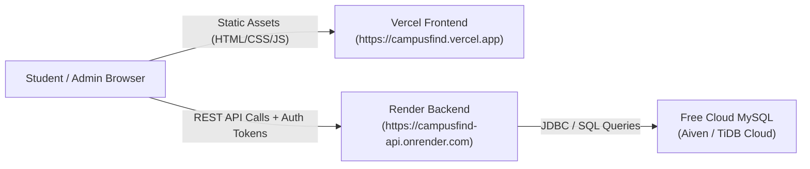

# 🚀 Free Online Deployment Guide — CampusFind

This step-by-step guide explains how to deploy **CampusFind** online for **free** using:
* **Frontend:** [Vercel](https://vercel.com) (Global Edge CDN for HTML5/CSS3/JavaScript)
* **Backend:** [Render](https://render.com) (Free Web Service for Spring Boot & Java 17)
* **Database:** Free Managed MySQL on [Aiven](https://aiven.io) or [TiDB Cloud](https://tidbcloud.com)

---

## 🏗️ Architecture Overview



---

## STEP 1: Set Up a Free Cloud MySQL Database

You need a publicly accessible MySQL database so the Render backend can connect to it.

### Option A: Aiven for MySQL (Recommended — Free Tier)
1. Go to [aiven.io](https://aiven.io/) and create a free account (no credit card required).
2. Click **Create Service** → Select **MySQL** → Select the **Free Tier**.
3. Choose your nearest cloud region (e.g., AWS / Google Cloud).
4. Give your service a name: `campusfind-db` and click **Create Service**.
5. Once running (1–2 minutes), copy the following connection details from the Aiven Overview dashboard:
   * **Host:** `mysql-xxxx-xxxx.aivencloud.com`
   * **Port:** `12345` (e.g. your assigned port)
   * **User:** `avnadmin`
   * **Password:** *(Click to reveal and copy)*
   * **Database:** `defaultdb` (or create `campusfind_db`)
6. Construct your JDBC URL:
   ```
   jdbc:mysql://<HOST>:<PORT>/defaultdb?sslmode=require&serverTimezone=UTC&allowPublicKeyRetrieval=true
   ```

### Option B: TiDB Cloud Serverless (Free Forever — MySQL Compatible)
1. Sign up at [tidbcloud.com](https://tidbcloud.com).
2. Create a free **Serverless Cluster**.
3. Click **Connect** → Choose **General** / **Java (JDBC)**.
4. Copy the connection string, username, and password.

### Initialize Tables on your Remote Database:
Connect using MySQL Workbench, DBeaver, or command line and run the contents of [`sql/schema.sql`](file:///c:/Users/HP/Downloads/CAMPUSFIND/sql/schema.sql):
```bash
mysql -h <HOST> -P <PORT> -u <USER> -p <DATABASE> < sql/schema.sql
```
*(Note: Spring Boot's `spring.sql.init.mode=always` will also automatically initialize the tables upon its first successful startup!)*

---

## STEP 2: Deploy Spring Boot Backend on Render

1. Push your project to a GitHub repository:
   ```powershell
   git init
   git add .
   git commit -m "Deploy CampusFind to Render and Vercel"
   git remote add origin https://github.com/<your-username>/campusfind.git
   git push -u origin main
   ```
2. Go to [dashboard.render.com](https://dashboard.render.com/) and sign in with GitHub.
3. Click **New +** → Select **Web Service**.
4. Connect your `campusfind` repository.
5. Configure the service settings:
   * **Name:** `campusfind-api`
   * **Region:** Select the region closest to your database
   * **Branch:** `main`
   * **Runtime:** **Docker** *(Render will detect the included `Dockerfile` automatically)*
   * **Instance Type:** **Free**
6. Scroll down to **Environment Variables** and add the following keys:

| Environment Variable | Value | Description |
| :--- | :--- | :--- |
| `PORT` | `10000` | Dynamic port Render binds to |
| `DB_URL` | `jdbc:mysql://<HOST>:<PORT>/<DB>?useSSL=true&serverTimezone=UTC` | Your cloud MySQL JDBC URL from Step 1 |
| `DB_USERNAME` | `<YOUR_DB_USER>` | Cloud MySQL username |
| `DB_PASSWORD` | `<YOUR_DB_PASSWORD>` | Cloud MySQL password |
| `CORS_ALLOWED_ORIGINS` | `https://*.vercel.app,http://localhost:3000` | Whitelist for Vercel and local testing |
| `MAIL_ENABLED` | `false` | Keeps reset token logging active for dev |

7. Under **Advanced**, set **Health Check Path** to:
   ```
   /api/items/stats
   ```
8. Click **Create Web Service**.
9. Render will build the Docker container and start your Spring Boot application.
10. Once deployed, Render will provide your public URL:
    ```
    https://campusfind-api.onrender.com
    ```
    *(Test it by opening `https://campusfind-api.onrender.com/api/items/stats` in your browser. You should see `{"success": true, ...}`).*

---

## STEP 3: Deploy Frontend on Vercel

The `frontend/` directory has been created and prepared with its own [`vercel.json`](file:///c:/Users/HP/Downloads/CAMPUSFIND/frontend/vercel.json) and [`config.js`](file:///c:/Users/HP/Downloads/CAMPUSFIND/frontend/js/config.js).

### Method 1: Via Vercel Web Dashboard (Recommended)
1. Go to [vercel.com](https://vercel.com) and log in with GitHub.
2. Click **Add New...** → **Project**.
3. Import your `campusfind` GitHub repository.
4. In the configuration screen:
   * **Framework Preset:** `Other`
   * **Root Directory:** Click **Edit** and choose **`frontend`**
   * **Build and Output Settings:** Leave defaults (no build command needed for static HTML/CSS/JS)
5. Click **Deploy**.
6. Vercel will deploy your site in ~15 seconds and assign a URL, e.g.:
   ```
   https://campusfind.vercel.app
   ```

### Method 2: Via Vercel CLI
```powershell
npm install -g vercel
cd frontend
vercel --prod
```

---

## STEP 4: Connect Frontend to Backend

Now, link your Vercel frontend to your Render backend:

1. Open [`frontend/js/config.js`](file:///c:/Users/HP/Downloads/CAMPUSFIND/frontend/js/config.js).
2. Replace `'https://campusfind-api.onrender.com'` with your actual Render URL:
   ```javascript
   window.CAMPUSFIND_CONFIG = {
       BACKEND_URL: 'https://your-actual-app-name.onrender.com',
       ...
   };
   ```
3. Commit and push:
   ```powershell
   git add frontend/js/config.js
   git commit -m "Point frontend to live Render backend"
   git push
   ```
   Vercel will auto-deploy the change in seconds!

> 💡 **Instant Testing Tip (No re-deploy needed):**
> You can test any frontend deployment immediately against any backend URL by opening your browser DevTools Console on your Vercel site and running:
> ```javascript
> localStorage.setItem('CAMPUSFIND_API_URL', 'https://your-backend.onrender.com');
> location.reload();
> ```

---

## STEP 5: Verification & Testing Checklist

Once deployed, run through this test checklist on your live Vercel URL:

* [ ] **Home Page:** Open `https://your-app.vercel.app`. Verify that the hero section loads with the live stats counter and pre-seeded item cards.
* [ ] **Search & Filters:** Search for `"AirPods"` or filter by `"Lost"` / `"Found"` and `"Electronics"`. Confirm cards update dynamically.
* [ ] **Registration:** Sign up a new student account (`test@college.edu`). Verify automatic login and welcome toast.
* [ ] **Login & Logout:** Sign in with `student@campusfind.edu` / `Student@123`. Verify session persistence and sign out cleanly.
* [ ] **Report Submission:** File a new lost item report with description and optional photo. Verify it immediately shows in the home directory and "My Reports".
* [ ] **Self-Service Resolution:** Mark your report as resolved. Verify badge changes to `"Reunited / Closed"`.
* [ ] **Admin Dashboard:** Log in as `admin@campusfind.edu` / `Admin@123`. Navigate to Admin Panel, inspect all listings, flag an inappropriate report, and verify audit log trail.
* [ ] **Password Recovery:** Request a reset on `/forgot-password.html`. In dev mode, verify reset link appears and allows password update.

---

## 🔒 Security Summary for Deployment

* **CORS Whitelist:** Render backend only accepts requests from your Vercel domains (`https://*.vercel.app`) and local testing ports.
* **Credentials Protected:** Database user and password are set exclusively as **Render Environment Variables** and are never committed to Git or exposed to the client.
* **Cross-Origin Authentication:** Implements dual `HttpSession` + `X-Auth-Token` header fallback, guaranteeing seamless authentication even across cross-origin third-party cookie restrictions.
* **Passwords Hashed:** Stored as Blowfish-salted **BCrypt** hashes in MySQL.
